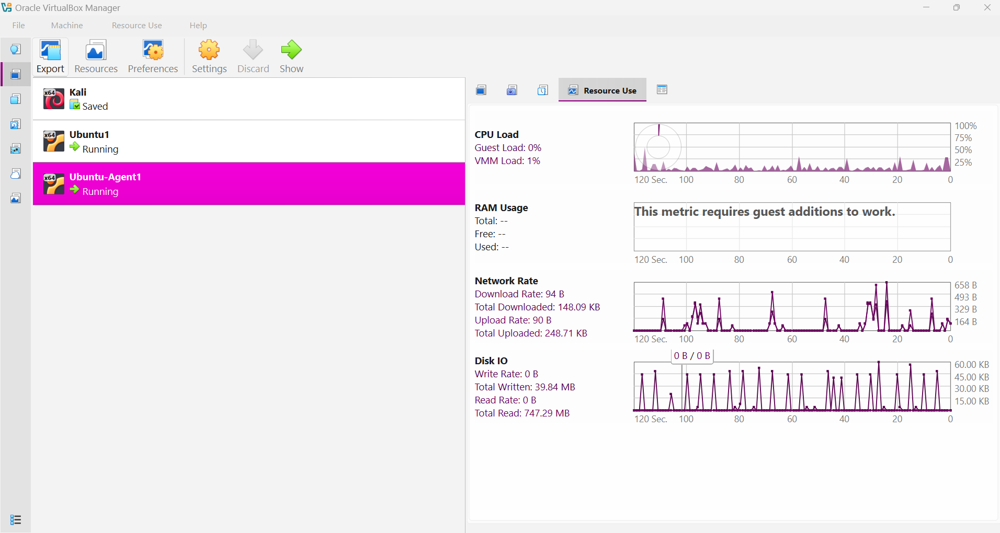
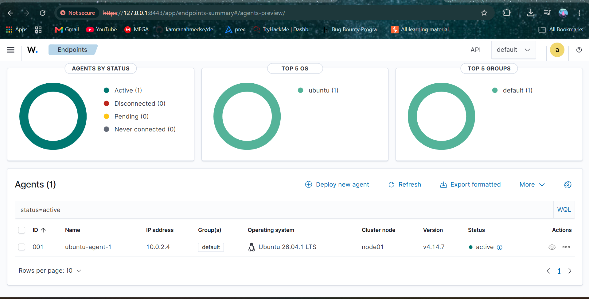
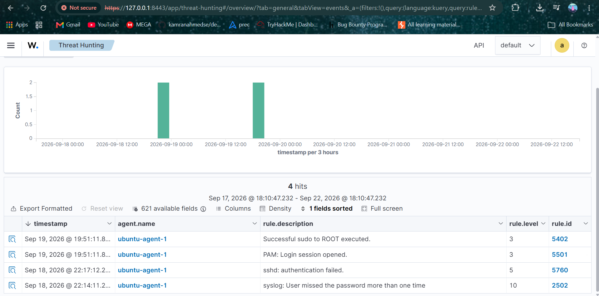
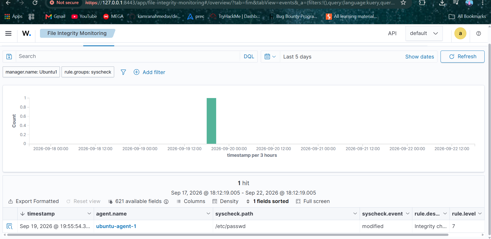

# Home SIEM Lab — Wazuh

A home detection and incident response lab built with Wazuh (open-source SIEM/XDR), VirtualBox and Kali Linux. A Wazuh server monitors an Ubuntu Server agent over a private NAT network, while a Kali Linux VM simulates attacks.

## Architecture

- **Wazuh server** (Ubuntu Server VM): manager + indexer + dashboard, all-in-one installation
- **Monitored agent** (separate Ubuntu Server VM): the endpoint monitored by the server
- **Kali Linux** (VM): attacker machine used for simulations
- All VMs are connected through a private VirtualBox NAT Network

## Scenarios tested

| Scenario | Result | Rule triggered |
|---|---|---|
| SSH brute force (Kali → agent) | Detected (32 authentication failures in the dashboard) | Rule 2502, level 10 |
| Nmap port scan (Kali → agent) | **Not detected.** Wazuh is a host-based tool (HIDS) and does not monitor external network traffic without an additional network IDS (NIDS) component | — |
| Critical file modification (`/etc/passwd`) | Detected after enabling real-time monitoring (inotify) | `syscheck` group, level 7 |

**SSH brute-force alert:**

**File Integrity Monitoring alert:**

## Documentation

- [Build journal](./build-journal.md): the full project journal with steps followed, errors encountered, how I fixed them and what I learned
- [Incident response playbook](./incident-response-playbook.md): triage and response steps for each tested alert type

## Key lessons

- VirtualBox network modes (Bridged vs NAT vs NAT Network) and their impact on performance
- Periodic scanning vs real-time monitoring (inotify) in File Integrity Monitoring
- Systematic troubleshooting: isolating a slow-network problem with `top`, `ps aux` and speed tests
- HIDS vs NIDS: what each can and cannot detect
- Writing an incident response playbook based on scenarios I tested myself, not on theory

## Limitations

- No network IDS component, so network-level activity such as port scans is not detected
- A single monitored agent

## Tech stack

Wazuh 4.14.7, VirtualBox, Ubuntu Server, Kali Linux, SSH
